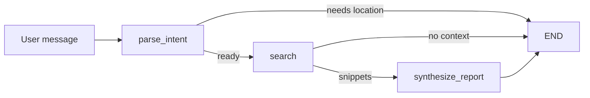

# Competitor intelligence (LangGraph)

Conversational pipeline that combines an LLM with web search to produce **nearby clothing-store competitor briefings**, including **peak-hour and footfall cues** grounded in public web snippets (always verify with your own data).

## Setup

```bash
cd langraph_project
python -m venv .venv
.venv\Scripts\activate
pip install -e .
```

Copy `.env.example` to `.env` and set `OPENAI_API_KEY`. If DuckDuckGo returns no results in your network, add `TAVILY_API_KEY` from [Tavily](https://tavily.com/) for more reliable web search.

## Run

Run from the project directory so `.env` is found (or export variables in your shell).

Interactive:

```bash
competitor-intel
```

Equivalent:

```bash
python -m competitor_intel
```

Single question:

```bash
competitor-intel --query "Clothing competitors and busy hours in Koramangala, Bangalore for our marketing team"
```

Async invocation for one shot:

```bash
competitor-intel --query "..." --async-run
```

### Verify install (no API calls)

```bash
python -m unittest discover -s tests -p "test_*.py"
```

## Architecture



- **LangGraph** workflow: parse intent → search (**Tavily** if `TAVILY_API_KEY` is set, else **DuckDuckGo**) → synthesize markdown report.
- **Services**: intent parsing, search formatting, report generation (kept out of the CLI entrypoint).
- **Config**: `OPENAI_*` validated at startup via Pydantic Settings.

## Note on data

Footfall and “popular times” are inferred from **search results**, not a proprietary footfall API. Treat numbers and rankings as directional, not exact measurements.
